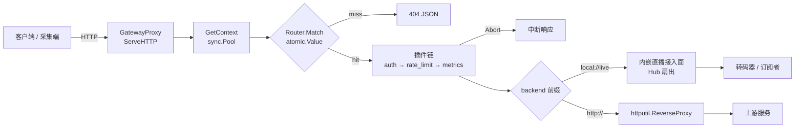

# ZetaGateway · 高性能无锁动态 API 网关

> 仓库名 `go-apisix-extend`（Go module 名），项目对外名 **ZetaGateway**。

基于 Go 标准库 `net/http` + `httputil.ReverseProxy` 自研的轻量 API 网关：**无锁路由（Copy-On-Write）**、
**零分配上下文池**、**洋葱模型插件链**、**YAML 热加载**，并内嵌一个 **MPEG-TS 直播接入面**（发布/订阅扇出），
用于把「摄像头 → 网关 → 转码器 → 浏览器」串成一条真实可跑的视频链路。

| 指标（本机实测，1000 条路由、并行 16 线程） | 数值 |
|---|---|
| 路由匹配 `BenchmarkMatch` | **4.28 – 17.23 ns/op，0 B/op，0 allocs/op** |
| 完整请求路径（池 → 路由 → 插件 → 本地处理器，不含网络） | **70.84 – 77.22 ns/op，0 allocs/op** |
| 上下文池 Get/Set/Put | 27.71 ns/op，0 allocs/op |
| 优化前 `BenchmarkMatch`（`fmt.Sprintf` 拼 key） | 29.55 ns/op，56 B/op，3 allocs/op |

原始输出与复测命令：[`doc/bench-report.md`](doc/bench-report.md)。

## 特性

- **无锁路由**：`atomic.Value` 持有不可变路由表，写时复制整表后原子替换 —— 读路径无锁、无阻塞、**零堆分配**（精确匹配 O(1)，前缀匹配最长优先，`method: "*"` 匹配任意方法）。
- **零分配上下文**：`sync.Pool` 复用 `GatewayContext`，请求结束 `Reset()` 回池；`UserData` 预分配 + 高水位重建，避免动态扩容逃逸。
- **洋葱模型插件链**：`Use` 注册、`ctx.Next()` 下钻、`ctx.Abort()` 中断；内置 `auth`（Header 校验，JWT 校验位预留）、`rate_limit`（CAS 令牌桶，无锁补充）、`metrics`（计数/延迟，默认未接线）。
- **配置热加载**：`fsnotify` 监听 YAML，重建路由与插件链并替换 `Server.Handler`；直播 Hub 复用同一实例，重载不打断在线推流。
- **内嵌直播接入面**：`PUT|POST /ingest/live/{name}` 推流、`GET` 拉流、`GET .../stats` 单路统计；每订阅者独立队列，慢订阅者**整块丢弃**且不阻塞发布端（MPEG-TS 有 0x47 同步字节，丢块后可自行重同步）；同一路流只允许一个发布者，冲突返回 `409`。
- **`local://` 本地处理器**：路由 `backend: local://live` 时交给进程内 Handler，媒体面不再走反向代理，但仍复用路由与插件链。
- **优雅关闭**：`SIGINT/SIGTERM` → `Server.Shutdown`（带 `shutdown_timeout`）。
- **上游连接池调优**：克隆 `http.DefaultTransport`，把 `MaxIdleConns` 提到 10000、`MaxIdleConnsPerHost` 提到 2000、`IdleConnTimeout` 提到 90s（标准库默认每 host 只有 2 个空闲连接）；连接池是包级单例，配置热加载复用同一实例。

## 架构



## 快速开始

要求 Go 1.18+（实测 go1.27.4，Windows 11 / Linux 均可）。

```powershell
cd go-apisix-extend

# 1) 用示例配置启动（默认监听 0.0.0.0:8080）
go run ./cmd/server -config config.yaml

# 2) 另起一个上游用于验证转发（示例路由指向 127.0.0.1:18080）
#    任意静态服务都可以，例如：python -m http.server 18080
curl.exe http://127.0.0.1:8080/api/v1/users
```

```powershell
# 3) 单元测试 / 竞态检测 / 基准
go test ./...
$env:CGO_ENABLED = 1; go test -race ./...   # -race 需要 cgo
go test ./pkg/router -run XXX -bench . -benchmem
```

### 端到端串流（可选）

`config.chain.yaml` 是 8082 端口的串流演示配置：网关内嵌媒体面 + 反代大屏。

```powershell
go run ./cmd/server -config config.chain.yaml
# 推流端见 go-agent-collect/cmd/cam-push；转码端见 go-nexus-stream
#   NEXUS_INPUT_URL=http://127.0.0.1:8082/ingest/live/cam0
```

> 三个仓库同属一个工作区工程，跨仓库文档（全链路说明）不在本仓库内。

## 配置说明

```yaml
server:
  host: "0.0.0.0"
  port: 8080
  read_timeout: 10s        # 长连接场景（推流/WS）必须置 0s
  write_timeout: 30s
  shutdown_timeout: 5s

routes:
  - method: "GET"          # 支持 "*" 匹配任意方法
    path: "/api/v1/users"  # 以 * 结尾为前缀匹配，如 /api/*
    backend: "http://127.0.0.1:18080"
    weight: 1              # 预留：负载均衡权重（当前未实现多后端）
    plugins: ["auth"]      # 预留：路由级插件（当前插件链为全局）

plugins:
  auth:
    secret: "change-me"
    enabled: true
  rate_limit:
    rate: 1000             # 每秒补桶数
    capacity: 100          # 桶容量（突发上限）
    enabled: true

live:
  enabled: true
  publish_token: "nexus-demo-token"   # 推流头 X-Ingest-Token；留空不校验
  queue_size: 64                      # 每订阅者缓冲块数（单块 ≤64KB）
  idle_timeout: 30s                   # 订阅空闲多久主动断开
```

## 接口与行为

| 场景 | 行为 |
|---|---|
| 无路由命中 | `404` + `{"error":"route not found","code":404}` |
| 上游不可达 | `502` + `{"error":"upstream_error",...}`；超时返回 `504` |
| 转发头 | 自动补 `X-Real-IP`、`X-Forwarded-For`、`X-Forwarded-Host` |
| 响应头 | 统一追加 `X-Gateway: go-apisix-extend` |

直播接入面（`live.enabled=true` 时）：

| 方法 | 路径 | 说明 |
|---|---|---|
| PUT / POST | `/ingest/live/{name}` | 采集端推流（`Content-Length: -1`，chunked body，建议 MPEG-TS） |
| GET | `/ingest/live/{name}` | 订阅拉流（chunked 响应） |
| GET | `/ingest/live/{name}/stats` | 单路统计（`bytes_in/bytes_out/chunks_in/dropped/silence_ms`…） |
| GET | `/ingest/live` | 全部流统计 |

推流鉴权在读取 body **之前**完成（`X-Ingest-Token` 常量时间比较），因此采集端能立刻拿到 `401`/`409`，不会白推一帧。

## 性能与取舍

- 读路径（每请求必经）**0 allocs/op**：路由键改为字符串拼接并内联进 map 下标，编译器不再分配临时字符串。
- 写路径是 O(路由表长度) 的整表复制：表长 10 / 100 / 1000 条时约 **1.09 / 4.11 / 25.33 µs**，约 24.5 ns/条。
  定位是「**低频写、高频读**」：规则热更新不会阻塞在途请求，但不要用它做每秒级的高频增删。
- 进程内开销 ≠ HTTP 吞吐。真实 QPS 受网络栈、TLS、上游影响，请用 `wrk` / `hey` 在目标机器复测（命令见压测报告第 7 节）。

## 目录结构

```
cmd/server/           服务入口：装配路由、插件链、直播 Hub、热加载、优雅关闭
pkg/router/           Lock-Free 路由（COW + atomic.Value），精确/前缀匹配
pkg/context/          GatewayContext 上下文池（零分配）
pkg/plugin/           洋葱模型插件链：auth / rate_limit / metrics
pkg/proxy/            反向代理封装 + local:// 本地处理器 + 错误收敛
pkg/live/             MPEG-TS 直播接入面（发布/订阅扇出、单发布者、慢订阅丢弃）
pkg/config/           YAML 配置 + fsnotify 热加载
config.yaml           控制面示例配置（8080）
config.chain.yaml     端到端串流示例配置（8082）
doc/                  设计文档、压测报告、对外介绍
```

## 已知边界（明确不承诺）

- **单实例内存扇出**：`live` 的流注册表在进程内，多实例横向扩展需要外部调度把「流 → 实例」绑定。
- **无重试 / 无熔断 / 无主动健康检查**：上游失败直接按 502/504 返回，重试策略交给上游或调用方。
- **无负载均衡**：`weight` 字段已解析但未使用，一条路由对应一个后端地址。
- **插件链是全局的**：路由里的 `plugins` 字段已解析但暂未生效；`metrics` 插件已实现但默认未接线。
- 正则路径、方法级细粒度路由未实现（接口已预留 `matchRegex`）。

## 文档

- [`doc/specification.md`](doc/specification.md) 规格说明
- [`doc/ZetaGatewayReadme.md`](doc/ZetaGatewayReadme.md) 详细介绍（优化点、实测数据）
- [`doc/bench-report.md`](doc/bench-report.md) 压测报告（环境、原始输出、复测命令）
- [`doc/architecture.drawio`](doc/architecture.drawio) 架构图（diagrams.net 打开）

## 许可证

[MIT](LICENSE) © 2026 qianyufu178-ux
